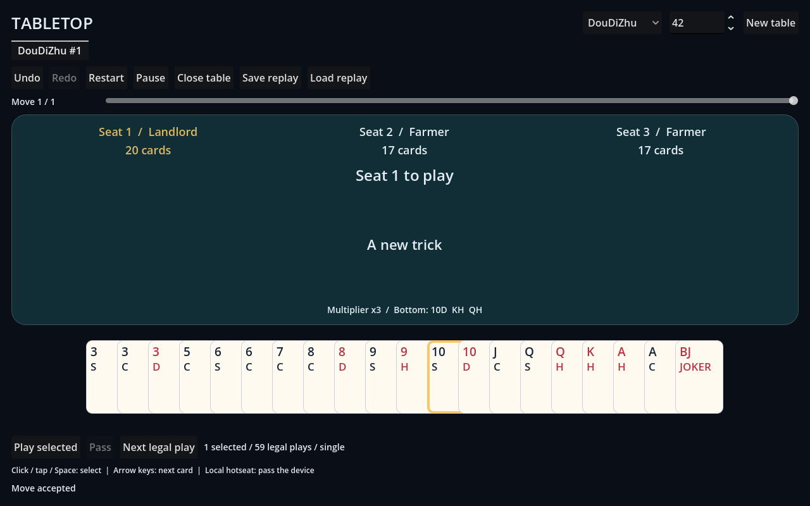
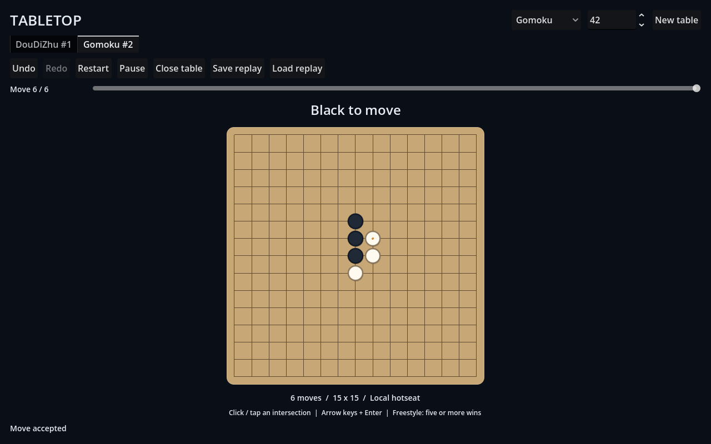

# Godot Tabletop

A Godot 4 local client engine for multiple card and board games. **DouDiZhu and freestyle Gomoku are playable through the same client host.**

面向多种棋牌游戏的 Godot 4 客户端工作引擎。当前先完成本地规则接入、界面、输入、对局管理与回放；远端房间和 AI 后延。

## Local client

- Godot **4.6-stable**, standard GDScript build, Compatibility renderer; no Mono.
- Register each game as a module containing its rules adapter and view scene. The host has no game-specific command or state branches.
- Create, switch, restart, pause, and close independent local tables, including different games in one workspace.
- Undo, redo, seek through accepted commands, and branch by playing from an earlier position.
- Save a complete JSON replay with a file picker; load it as a new table. Invalid archives leave all live tables unchanged.
- Reject commands queued by an old view after a move, switch, history seek, pause, restart, or close.
- Reusable card presentation with per-view input ownership, and an independent grid/piece widget. Mouse, touch, and keyboard paths are exercised in the actual scenes.

| Game | Implemented profile |
| --- | --- |
| DouDiZhu | Three-seat hotseat, bidding and redeal, 14 combination types, legal-play browser, pass/trick reset, multipliers, spring and scoring |
| Gomoku | Two-seat hotseat, 15 × 15 freestyle board, five or more connected stones wins, four line directions, full-board draw, winning-line display |

Chess, Xiangqi, and additional card games need their own rule adapters and views. The client contract does not assume cards, a landlord, or placement-only commands. See [how to add a game](docs/CLIENT_ENGINE.md).




## Run

Open `project.godot` with Godot 4.6-stable and press F5.

1. Choose a game and seed, then **New table**. Use the tabs to switch games without losing their progress.
2. DouDiZhu: bid, select cards, then **Play selected** or **Pass**. **Next legal play** selects an available play without executing it. Click/tap/Space selects a card; left/right moves keyboard focus.
3. Gomoku: click/tap an intersection, or navigate with arrows and place with Enter/Space.
4. Use **Undo**, **Redo**, or the move slider to review history. A new accepted move from an earlier position discards the old redo tail.
5. **Save replay** saves the full timeline, including the redo tail while reviewing. **Load replay** opens a new independent table at the end of that archive.

Ctrl/Cmd+Z undoes, Ctrl/Cmd+Shift+Z or Ctrl/Cmd+Y redoes, Ctrl/Cmd+S saves, and Ctrl/Cmd+O opens a replay.

This is local hotseat: pass the device between players. Replay archives contain the seed and all private hands; keep them separate from player observations. `S/H/C/D` on cards mean spades/hearts/clubs/diamonds; `SJ/BJ` are the small/big jokers.

## Downloadable development clients

Successful [Godot workflow runs](https://github.com/qigao/godot-tabletop/actions/workflows/godot.yml) publish `Tabletop-Linux`, `Tabletop-Windows`, and `Tabletop-macOS` artifacts. Download and extract the artifact, then extract the enclosed client ZIP and run `RunTabletop.sh`, `RunTabletop.cmd`, or `RunTabletop.command`.

Each bundle includes the project PCK and the verified official standard Godot runtime. It uses the editor-capable runtime; it is a development client rather than a stripped release export. The scene suite also runs against the PCK before packaging. Signed desktop distribution, browser/mobile exports, and physical touchscreen acceptance remain separate work in [#2](https://github.com/qigao/godot-tabletop/issues/2).

## Check

```sh
python scripts/check.py /absolute/path/to/Godot
```

The runner imports the project and executes the rule, legal-action, local client, and real addon scene suites. It rejects script errors even when Godot exits zero. CI runs the same checks and PCK scene acceptance on Linux, Windows, and macOS. Official standard engine archives are pinned, verified, and downloaded with `curl`.

Acceptance covers 32 complete seeded single/pass DouDiZhu matches, 96 complete mixed-combination matches with all 14 kinds played, bounded exhaustive legal-action comparisons, 935 pinned upstream action fixtures, Gomoku wins and a 225-move draw, JSON round trips, independent tables, history branching, malformed archives, scoped input, native scene lifecycle, and resize. These match drivers are tests. They do not provide production AI.

Linux CI additionally renders the actual desktop client at 1280 × 800 and 800 × 600, publishing `Client-layouts`. The committed images are real local OpenGL captures. Automated event injection and rendered screenshots do not establish physical device input acceptance.

## Structure

| Path | Responsibility |
| --- | --- |
| `core/` | Rules contract, session authority, revision checks, replay, module catalog |
| `client/` | Module/view contracts, local table lifecycle, workspace and history |
| `games/` | Separate game profiles and module descriptors |
| `ui/tabletop_app.gd` | Generic workspace host, toolbar, tabs, replay dialogs |
| `ui/views/` | Game-specific observation and command adapters |
| `ui/widgets/`, `ui/card_*.gd`, `ui/selection_hand.gd` | Reusable board/card presentation and scoped input |
| `addons/card-framework/` | Pinned upstream MIT addon |
| `tests/` | Rules, local engine, replay, scene/input and native render acceptance |

Read [architecture](docs/ARCHITECTURE.md), [client integration](docs/CLIENT_ENGINE.md), [the DouDiZhu profile](docs/DOUDIZHU.md), [the action fixture boundary](docs/DOUZERO_ACTIONS.md), [the roadmap](docs/ROADMAP.md), and [upstream provenance](THIRD_PARTY.md).

## License

MIT for original project code. The vendored addon retains Hyunjoon Park's MIT notice. See [LICENSE](LICENSE) and [THIRD_PARTY.md](THIRD_PARTY.md).
