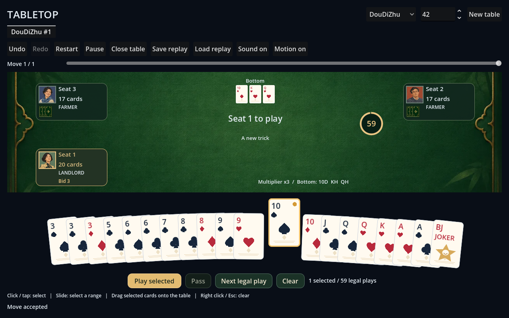
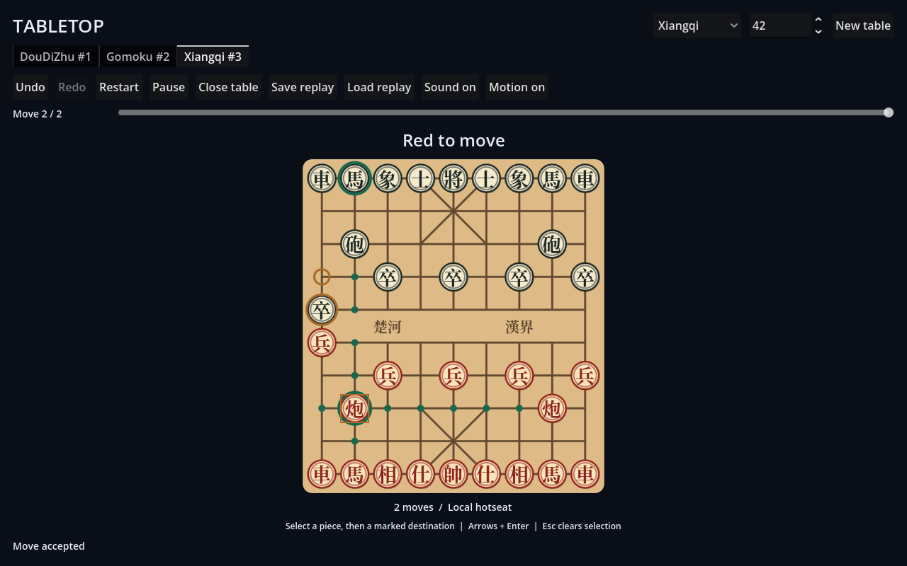
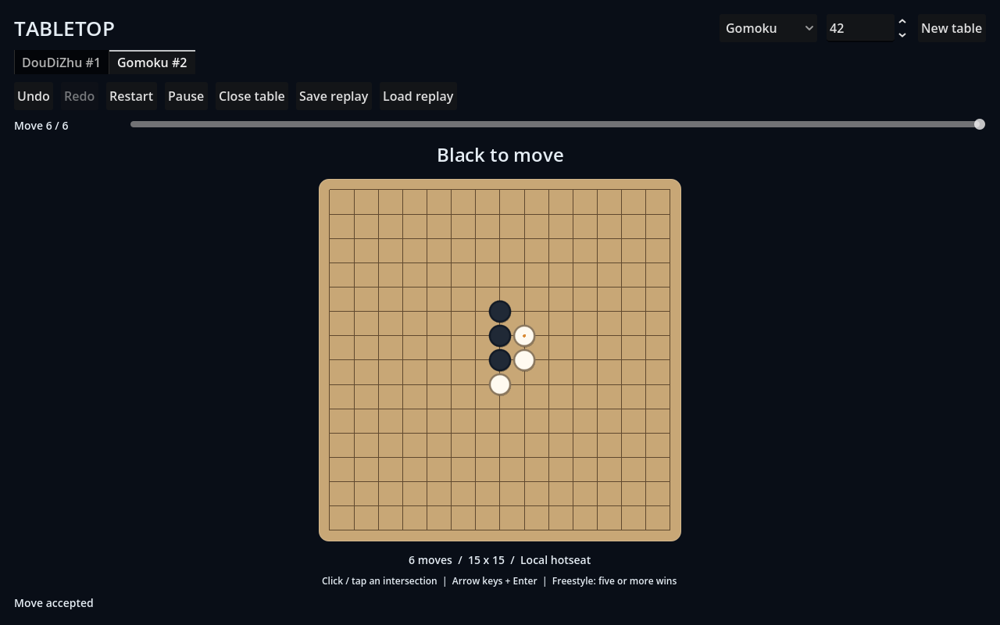
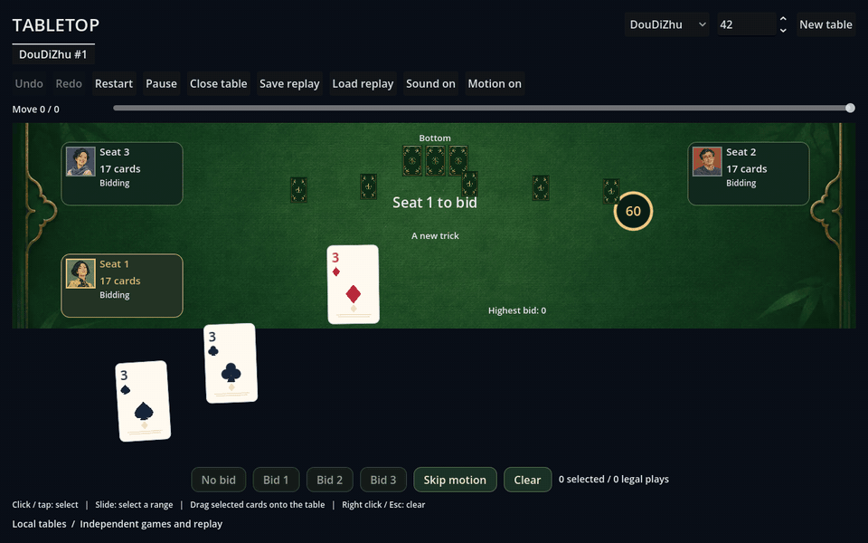

# Godot Tabletop

A Godot 4 local client engine for multiple card and board games. **DouDiZhu, freestyle Gomoku and Xiangqi are playable in the same workspace.**

面向多种棋牌游戏的 Godot 4 客户端工作引擎。当前先完成本地规则接入、界面、输入、对局管理与回放；远端房间和 AI 后延。

## Local client

- Godot **4.6-stable**, standard GDScript build, Compatibility renderer; no Mono.
- Register rules, a shared scene, layout/interaction configuration and artwork/audio as a module. Card tables and boards use their own shared components. All three games use this descriptor contract.
- Create, switch, restart, pause, and close independent local tables, including different games in one workspace.
- Undo, redo, seek through accepted commands, and branch by playing from an earlier position.
- Save a complete JSON replay with a file picker; load it as a new table. Invalid archives leave all live tables unchanged.
- Reject commands queued by an old view after a move, switch, history seek, pause, restart, or close.
- Reusable card-table, placement-board and move-board templates with declarative bindings and legal-action-driven controls. Media are replaceable, and **Sound on/off** persists across games. The scene tests exercise mouse, touch and keyboard input.

| Game | Implemented profile |
| --- | --- |
| DouDiZhu | Three-seat hotseat, bidding and redeal, 14 combination types, legal-play browser, pass/trick reset, multipliers, spring and scoring |
| Gomoku | Two-seat hotseat, 15 × 15 freestyle board, five or more connected stones wins, four line directions, full-board draw, winning-line display |
| Xiangqi | Two-seat hotseat, standard opening, select-to-move with legal destinations, checkmate, stalemate loss and local repetition adjudication. [Rules profile](docs/XIANGQI.md) |

DouDiZhu opens with the [Bamboo Court theme](games/doudizhu/assets/bamboo_court/README.md), with a jade table, illustrated seat portraits, standard suit pips and event-driven music and effects.





## Interaction baseline

Card interaction is part of client acceptance. The DouDiZhu example now includes a curved hand with stable hover hits and raised selection, mouse/touch range selection, group drag-to-play with legal target feedback, relative player badges/counts, public bottom/played cards, sequential dealing/reveal/play motion, active countdown, configured pattern/low-card feedback and looping music, plus a result panel with new-round/close actions.

**Motion on/off**, **Skip motion**, pointer thresholds, seat anchors, timing and event/media mappings are configurable. Rule-complete play is only one part of acceptance. See [the reference behavior mapping and interaction checks](docs/INTERACTION.md).

File dialogs and window/application focus loss suspend input, countdown and music without changing user pause or replay history. Interruption cancels old gestures/callbacks; returning focus resumes the remaining time. Saved replays use the snapshot selected when the dialog opened.



## Run

Open `project.godot` with Godot 4.6-stable and press F5.

1. Choose a game and seed, then **New table**. Use the tabs to switch games without losing their progress.
2. DouDiZhu: bid, select cards, then **Play selected** or **Pass**. **Next legal play** selects an available play without executing it. Click/tap/Space selects a card; sliding selects a range, dragging onto the table plays a legal selection, right-click/Escape clears, and Shift+arrows extends keyboard selection.
3. Gomoku: click/tap an intersection, or navigate with arrows and place with Enter/Space.
4. Xiangqi starts with Red. Select a piece and a marked destination by click, tap or arrows + Enter. Escape and right click clear the selection.
5. Use **Undo**, **Redo**, or the move slider to review history. A new accepted move from an earlier position discards the old redo tail.
6. **Save replay** saves the full timeline, including the redo tail while reviewing. **Load replay** opens a new independent table at the end of that archive.

Ctrl/Cmd+Z undoes, Ctrl/Cmd+Shift+Z or Ctrl/Cmd+Y redoes, Ctrl/Cmd+S saves, and Ctrl/Cmd+O opens a replay.

This is local hotseat: pass the device between players. Replay archives contain the seed and all private hands; keep them separate from player observations. `S/H/C/D` in text summaries mean spades/hearts/clubs/diamonds. `SJ/BJ` are the small/big jokers.

## Downloadable development clients

Successful [Godot workflow runs](https://github.com/qigao/godot-tabletop/actions/workflows/godot.yml) publish `Tabletop-Linux`, `Tabletop-Windows`, and `Tabletop-macOS` artifacts. Download and extract the artifact, then extract its client ZIP.

- On Windows x64, double-click `Tabletop.exe`. The unsigned export contains the Godot 4.6 release runtime and the game pack in the executable. CI starts the exported executable directly.
- On Linux x64 or macOS, open `RunTabletop.sh` or `RunTabletop.command`. These development bundles include `client.pck` and the editor-capable runtime.

The scene and viewport interaction suites run from an exported PCK before packaging on all three platforms. Signed desktop distribution, browser/mobile exports and physical touchscreen acceptance are tracked in [#2](https://github.com/qigao/godot-tabletop/issues/2).

## Check

```sh
python scripts/check.py /absolute/path/to/Godot
```

The runner imports the project and executes the rule, legal-action, local client, and real addon scene suites. It rejects script errors even when Godot exits zero. CI runs the same checks and PCK scene acceptance on Linux, Windows, and macOS. Official standard engine archives are pinned, verified, and downloaded with `curl`.

Acceptance covers 32 complete seeded single/pass DouDiZhu matches, 96 complete mixed-combination matches with all 14 kinds played, bounded exhaustive legal-action comparisons, 935 pinned upstream action fixtures, Gomoku wins and a 225-move draw, JSON round trips, independent tables, history branching, malformed archives, scoped input, native scene lifecycle, and resize. Actual viewport scenarios additionally cover motion, pointer gestures, legal drops, timer/lifecycle cancellation and settlement. Three additional complete DouDiZhu games run through the configured controls, and a string-card fixture reuses the same renderer. Media checks cover real imported resources, live cues and silent history navigation. These match drivers are tests. They do not provide production AI.

Xiangqi acceptance checks opening move counts, movement restrictions, checkmate, stalemate and repetition. The source and packed scenes exercise selecting a piece, keyboard and touch moves, pause, undo, replay and a complete drawn game. Linux captures the game at both tested window sizes.

Linux CI additionally renders the actual desktop client at 1280 × 800 and 800 × 600 and records an interaction GIF, publishing `Client-layouts`. The committed images are real local OpenGL captures. Automated event injection and rendered screenshots do not establish physical device input acceptance.

## Structure

| Path | Responsibility |
| --- | --- |
| `core/` | Rules contract, session authority, revision checks, replay, module catalog |
| `client/` | Module/view contracts, local table lifecycle, workspace and history |
| `games/` | Separate game profiles and module descriptors |
| `ui/tabletop_app.gd` | Generic workspace host, toolbar, tabs, replay dialogs |
| `ui/cards/`, `ui/boards/` | Configurable card-table, placement-board and move-board renderers |
| `client/presentation/` | Layout/media resources, value bindings and local cue playback |
| `ui/widgets/`, `ui/card_*.gd`, `ui/selection_hand.gd` | Reusable board/card presentation and scoped input |
| `addons/card-framework/` | Pinned upstream MIT addon |
| `tests/` | Rules, local engine, replay, scene/input and native render acceptance |

Read [architecture](docs/ARCHITECTURE.md), [client integration](docs/CLIENT_ENGINE.md), [the DouDiZhu profile](docs/DOUDIZHU.md), [the action fixture boundary](docs/DOUZERO_ACTIONS.md), [the roadmap](docs/ROADMAP.md), and [upstream provenance](THIRD_PARTY.md).

## License

MIT for original project code. The vendored addon retains Hyunjoon Park's MIT notice. See [LICENSE](LICENSE) and [THIRD_PARTY.md](THIRD_PARTY.md).
